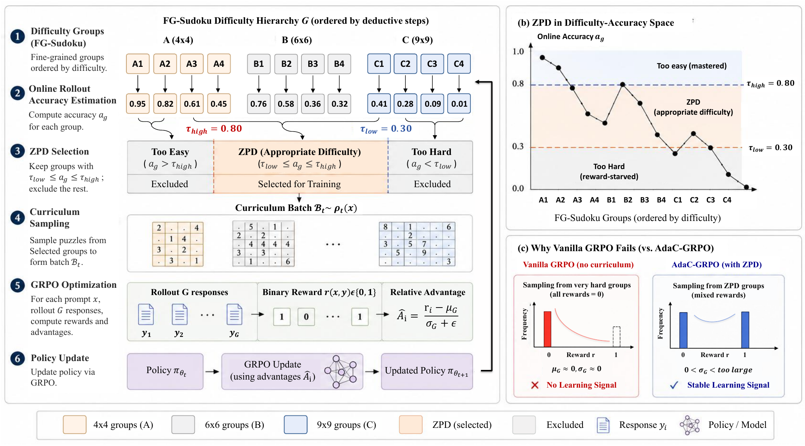
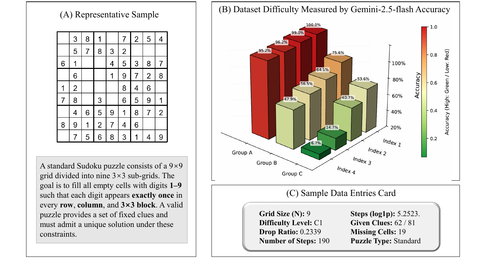
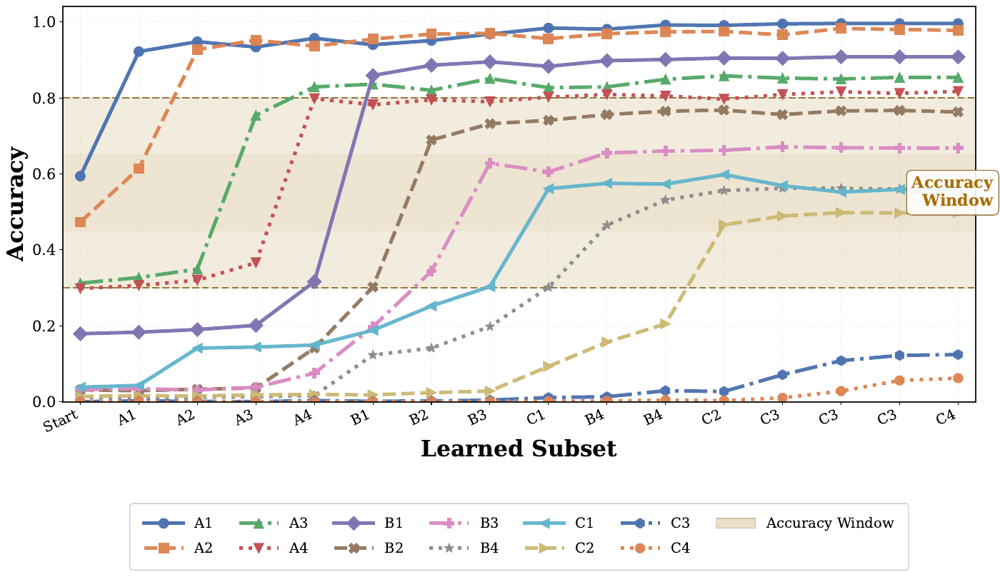

<div align="center">

# AdaC-GRPO

### Towards Mastering Long-Horizon Visual Sudoku Puzzles
**via Adaptive Curriculum Learning**

Sida Li · Yuanxin Liu · Linli Yao · Shicheng Li · Xu Sun · Haoli Bai · Xiao-Hui Li

**EMNLP 2026**

[](https://arxiv.org/abs/2610.13184)
[](https://2026.emnlp.org/)
[](https://www.python.org/)
[](THIRD_PARTY_NOTICES.md)

[Paper](https://arxiv.org/abs/2610.13184) · [Quick start](#quick-start) · [FG-Sudoku](#fg-sudoku) · [Results](#results) · [Training](docs/training.md) · [Citation](#citation)

</div>

AdaC-GRPO trains visual reasoning models with an **adaptive curriculum inside the model's Zone of Proximal Development**. Online rollout accuracy identifies difficulty groups that are challenging but still yield useful rewards, helping GRPO progress through long-horizon Sudoku reasoning.

<p align="center">
  
</p>

## Highlights

- **FG-Sudoku:** 3,072 training puzzles and 768 test puzzles across 4×4, 6×6, and 9×9 grids, with 12 solver-derived difficulty tiers.
- **Adaptive curriculum:** the paper uses a ZPD window of **[0.3, 0.8]**, selecting the highest-accuracy eligible group.
- **Stronger hard-grid reasoning:** Qwen2.5-VL-7B reaches **58.60% overall** and **21.89% on 9×9 grids**, compared with **42.71% / 3.91%** for standard GRPO.
- **Broader evaluation:** the paper also reports InternVL3.5 and Qwen3-VL results, threshold ablations, and transfer experiments.

Results and settings follow [arXiv:2610.13184v1](https://arxiv.org/html/2610.13184v1), released on October 9, 2026.

## Quick start

The bundled dataset can be checked **without a GPU or third-party Python packages**:

```bash
git clone https://github.com/DuHeng0128/AdaC-GRPO.git
cd AdaC-GRPO

python scripts/validate_data.py
python scripts/evaluate_predictions.py \
  --predictions examples/predictions.json \
  --allow-partial
```

The example contains the reference answer for one test puzzle and demonstrates the output format. Its 100% score is a data-path check, not a model result. Full benchmark scoring requires one prediction for every test puzzle; partial evaluation must be requested explicitly.

For training, use Linux with CUDA and see the [installation and training guide](docs/training.md).

## FG-Sudoku

| Split | 4×4, A1–A4 | 6×6, B1–B4 | 9×9, C1–C4 | Total |
| --- | ---: | ---: | ---: | ---: |
| Train | 1,024 | 1,024 | 1,024 | 3,072 |
| Test | 256 | 256 | 256 | 768 |
| SFT warm-start traces | — | — | — | 300 |

Each puzzle has an image, a numeric puzzle grid, a reference solution, and a difficulty label. Zeros mark empty cells; 6×6 grids use 2×3 blocks. Difficulty tiers are defined within each grid size and have unequal counts because solver costs are discrete.

<p align="center">
  
</p>

Use `data/sudoku/puzzles.json` for training and `data/sudoku_test/puzzles.json` for held-out evaluation. Both splits include puzzle images, numeric answers, solution images, and solver traces. The [dataset guide](docs/dataset.md) describes the schema and validation tools.

## Results

Paper Table 1, exact-grid pass@1 (%). A, B, and C denote 4×4, 6×6, and 9×9 grids. Qwen2.5-VL rows share the same backbone.

| Model / training method | A | B | C | Overall |
| --- | ---: | ---: | ---: | ---: |
| Qwen2.5-VL-7B, untuned | 41.04 | 2.35 | 0.00 | 14.46 |
| + SFT | 49.25 | 7.04 | 2.35 | 19.54 |
| + GRPO | 76.16 | 48.07 | 3.91 | 42.71 |
| + CurrReFT | 64.86 | 55.49 | 1.16 | 40.50 |
| + AdaRFT | 75.01 | 52.32 | 4.30 | 43.88 |
| + DAPO | **89.84** | 63.67 | 8.59 | 54.04 |
| **+ AdaC-GRPO** | 89.06 | **64.85** | **21.89** | **58.60** |
| Gemini-2.5-Flash, reference | 98.44 | 62.91 | 29.30 | 63.55 |
| Gemini-2.5-Pro, reference | 99.21 | 91.39 | 65.62 | 85.40 |

AdaC-GRPO closes **62.2% of the overall gap** from untuned Qwen2.5-VL-7B to Gemini-2.5-Pro. The paper reports a three-seed AdaC-GRPO mean of 58.20% with a standard deviation of 0.34 percentage points; the main-table configuration is 58.60% after rounding.

<details>
<summary><b>Architecture generalization and curriculum trajectory</b></summary>

| AdaC-GRPO backbone | A | B | C | Overall |
| --- | ---: | ---: | ---: | ---: |
| InternVL3.5-8B | 88.65 | 64.47 | 21.08 | 58.07 |
| Qwen3-VL-8B | 90.24 | 65.20 | 25.78 | 60.41 |

<p align="center">
  
</p>

These are paper-reported results, not measurements from the CPU quick start.

</details>

## Training and evaluation

The main configuration uses Qwen2.5-VL-7B, four 80 GB A800 GPUs, DeepSpeed ZeRO-3, and eight rollouts per prompt. Start with the 300-trace SFT warm-up, then run the curriculum:

```bash
# After installing the training environment described in docs/training.md:
MODEL_PATH=Qwen/Qwen2.5-VL-7B-Instruct bash scripts/run_sft_video.sh

MODEL_PATH="$PWD/outputs/sft" bash scripts/run_grpo_video.sh
```

Both launchers accept environment variables for model/output paths and GPU count. Defaults use three training epochs per stage, ZPD [0.3, 0.8], and a 1/4 online evaluation ratio without an additional sample cap.

To score model responses, save a JSON mapping from the image keys in `puzzles.json` to matrices or response strings, then run:

```bash
python scripts/evaluate_predictions.py \
  --predictions outputs/test_predictions.json \
  --output outputs/test_metrics.json
```

The evaluator reports per-tier, per-grid, and overall accuracy. See [docs/dataset.md](docs/dataset.md) for prediction schemas and the distinction between strict evaluation and training rewards.

## Repository guide

| Path | Purpose |
| --- | --- |
| [`src/open_r1/grpo.py`](src/open_r1/grpo.py) | Curriculum controller and GRPO training |
| [`src/open_r1/sft_video.py`](src/open_r1/sft_video.py) | SFT warm-up |
| [`src/open_r1/trainer/`](src/open_r1/trainer/) | Custom multimodal GRPO trainers |
| [`data/`](data/) | FG-Sudoku puzzles, metadata, solutions, and SFT examples |
| [`scripts/`](scripts/) | Launchers, CPU data validation, and prediction scoring |
| [`docs/`](docs/) | Dataset and training guides |
| [`tests/`](tests/) | CPU checks for data paths and exact-grid evaluation |

## Citation

```bibtex
@article{li2026adacgrpo,
  title   = {{AdaC-GRPO}: Towards Mastering Long-Horizon Visual Sudoku Puzzles via Adaptive Curriculum Learning},
  author  = {Li, Sida and Liu, Yuanxin and Yao, Linli and Li, Shicheng and Sun, Xu and Bai, Haoli and Li, Xiaohui},
  journal = {arXiv preprint arXiv:2610.13184},
  year    = {2026},
  note    = {Accepted to Findings of EMNLP 2026},
  url     = {https://arxiv.org/abs/2610.13184}
}
```

## Acknowledgments, license, and contact

The multimodal training infrastructure builds on [Video-R1](https://github.com/tulerfeng/Video-R1), [R1-V](https://github.com/Deep-Agent/R1-V), and Hugging Face TRL. The repository's [MIT License](LICENSE) covers original contributions; inherited Apache-2.0 code retains its original notices. See [THIRD_PARTY_NOTICES.md](THIRD_PARTY_NOTICES.md).

For questions, open a [GitHub issue](https://github.com/DuHeng0128/AdaC-GRPO/issues) or contact [Sida Li](mailto:lisida@stu.pku.edu.cn).
